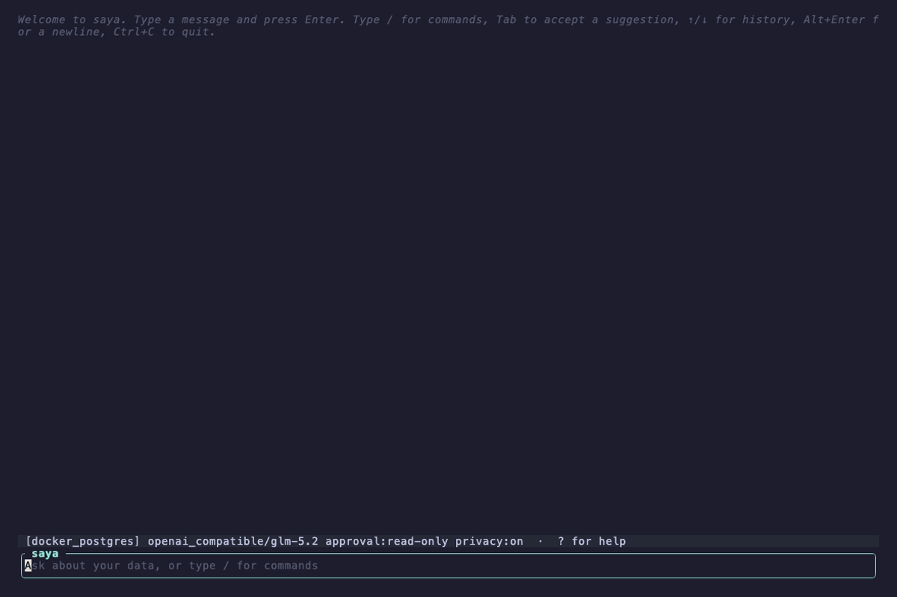

<p align="center">
  <picture>
    <source srcset="docs/brand/saya-logo-transparent-dark.svg" media="(prefers-color-scheme: dark)">
    
  </picture>
</p>

<h1 align="center">SAYA CLI</h1>

<p align="center"><em>Ask your database questions in plain language, from the terminal.</em></p>

<p align="center">
  <a href="https://crates.io/crates/saya-cli"></a>
  <a href="https://github.com/databook-studio/saya-cli/actions/workflows/ci.yml"></a>
  <a href="https://crates.io/crates/saya-cli"></a>
  
  <a href="LICENSE"></a>
</p>

<p align="center">
  <a href="#try-it-in-one-minute">Try it</a> ·
  <a href="#install">Install</a> ·
  <a href="#quick-start">Quick start</a> ·
  <a href="#safety">Safety</a> ·
  <a href="#documentation">Documentation</a>
</p>

<p align="center">
  
</p>

saya is a database-aware AI agent for the terminal. Ask questions in plain
language or run SQL directly. For agent queries, saya discovers the schema,
shows you the SQL, then runs it read-only with bounded results against
PostgreSQL, MySQL, SQLite, Snowflake, ClickHouse, or BigQuery. For local CSV,
Parquet, or JSON data, a job can analyse it with the `duckdb` CLI
through its `shell` tool — see [Files (CSV, Parquet)](docs/querying-databases.md#files-csv-parquet).

<p align="center">
  
</p>

One prompt builds a small product: saya writes [Neon Snake](examples/demo-snake/), a self-contained browser game, and runs its tests.

## Try it in one minute

No configuration needed — `saya demo` builds a small synthetic SQLite
database (customers and orders, planted with nulls, duplicate-join traps,
and date boundaries) and opens it read-only in the interactive UI:

```bash
saya demo
```

Schema browsing and `/sql` need no AI provider; to ask questions in plain
language, configure one (see below). With `--reset` it rebuilds the
fixture from scratch. For the whole journey — demo, setup, a trap question,
save, export, import on a second machine, and a stale-review refusal —
[`scripts/walkthrough.sh`](scripts/walkthrough.sh) runs and prints the
command-line journey.

## Connect your own database

`saya setup` is a guided flow: pick an AI provider (the API key is asked for
only as an environment-variable *name*, never its value), pick a database —
all six engines are guided, including Snowflake (keypair, browser SSO, or
password-env) — probe the connection, review the exact file changes, then
confirm. It needs a terminal; for scripts use `saya config init` as before.

```bash
saya setup
```

Existing config is preserved — setup appends to `connections.toml` and, if
your `config.toml` already exists, prints the `[ai]` snippet instead of
touching the file.

## Jobs

A job runs the coordinator in one working root with the same workspace tools a
helper holds, and delegates to helpers only when it chooses to. The root is the
stated folder itself by default — a Git repository included — with tool edits
recorded as before-images; `--managed` (or `[job] root_mode = "managed"`)
creates a managed checkout instead. `saya start <id> <task>` starts a job,
`saya follow-up` runs one more bounded child invocation, and `saya job <verb>`
runs the durable lifecycle (`list`, `show`, `events`, `resume`, `review`,
`apply`, `rewind`, and the rest).
Review and apply are explicit operator steps: a candidate applies only while
its digest and the original tree are unchanged. Inside the interactive session
the same grammar is `/start`, `/follow-up`, and `/job <verb>`, with `/approve`,
`/deny`, `/message`, `/pause`, `/continue`, and `/cancel-child` for the
session-only controls. `saya coding` and `/coding` are retired and answer with
the replacement. For explicit database selection, plan-first starts, and
operator review and apply, see
[job capabilities](docs/coding-capabilities.md).

## Saved investigations

When a question is answered well, save the SQL behind it:

```bash
saya investigation save --name "orders last week" --sql "SELECT ..." --connection analytics
saya investigation list                                  # prints the ids
saya investigation run orders-last-week-3f9a1c2b         # replays it, read-only
saya investigation export orders-last-week-3f9a1c2b out.json  # share it
```

An investigation is one portable JSON file: the exact SQL plus its name,
description, dialect, connection alias, and referenced tables — no
credentials, rows, results, or machine-specific identity. The SQL can bind
values by name (`WHERE region = :region`), declared at save with
`--param-spec name:type[:required]` and bound at run with `--param
name=value` — values are never stored, only names and a digest. The SQL is
stored verbatim (review it before sharing), replay never involves an AI
provider, and a run refuses when the referenced tables' schema, the target
connection, or the saved revision changed since the last reviewed run — or
when the review cannot be verified at all (a table that cannot be resolved,
an ambiguous name) — until `--revalidate`. → [commands](docs/commands.md)

## Install

Prebuilt binaries for macOS (Apple Silicon + Intel), Linux, and Windows are on
every [release](https://github.com/databook-studio/saya-cli/releases), with
`SHA256SUMS` to verify them.

```bash
brew install databook-studio/tap/saya   # macOS / Linux
cargo binstall saya-cli                 # prebuilt binary, no compile
cargo install saya-cli                  # from source (takes a few minutes)
```

Building from crates.io needs one flag for SQLite's maths functions, which the
released binaries already carry:

```bash
LIBSQLITE3_FLAGS=-DSQLITE_ENABLE_MATH_FUNCTIONS cargo install saya-cli
```

→ [installation](docs/installation.md)

## Quick start

From install to a first answer and a first job.

**1. Install** (any one):

```bash
brew install databook-studio/tap/saya   # macOS / Linux
cargo binstall saya-cli                 # prebuilt binary, no compile
cargo install saya-cli --locked         # from source
```

**2. Create a starter config:**

```bash
saya config init
```

It writes `config.toml` and `connections.toml` to your user config directory
(the command prints the path) and refuses to overwrite either file. The
starter `[ai]` block points at a local Ollama.

**3. Point `[ai]` at a provider.** Keep the key in your environment — never
inline in the file — and edit the `[ai]` block in `config.toml`:

```bash
export SAYA_API_KEY='...'          # OpenAI-compatible endpoint or gateway
# export OPENROUTER_API_KEY='...'  # OpenRouter
# export ANTHROPIC_API_KEY='...'   # Anthropic
```

```toml
# An OpenAI-compatible endpoint: a gateway, vLLM, LM Studio, OpenRouter…
[ai]
provider = "openai_compatible"
model = "your-model"
base_url = "https://api.example.test/v1"
api_key = { env = "SAYA_API_KEY" }
```

| Provider | `provider` | `base_url` | key |
| --- | --- | --- | --- |
| OpenAI-compatible | `openai_compatible` | your endpoint, ending `/v1` | `{ env = "SAYA_API_KEY" }` |
| [OpenRouter](https://openrouter.ai) | `openai_compatible` | `https://openrouter.ai/api/v1` | `{ env = "OPENROUTER_API_KEY" }` |
| [Anthropic](https://anthropic.com) | `anthropic` | omit (default) | `{ env = "ANTHROPIC_API_KEY" }` |
| Local [Ollama](https://ollama.com) | `ollama` | omit (default `http://localhost:11434`) | none |

**4. Connect a database.** Create a small SQLite database anywhere:

```bash
sqlite3 /tmp/saya-sample.db "CREATE TABLE orders (id INTEGER PRIMARY KEY, region TEXT, status TEXT, amount REAL); INSERT INTO orders (region,status,amount) VALUES ('eu','shipped',10.5),('us','pending',7.25);"
```

Append a profile to `connections.toml`:

```toml
[profiles.sample]
type = "sqlite"
path = "/tmp/saya-sample.db"
read_only = true
```

Point the default at it: set `default_profile = "sample"` at the top of
`config.toml` (or pass `--profile sample` to each command). The starter file
names an `analytics` PostgreSQL profile you have not connected yet.

Then check the setup. It names what is missing and exits non-zero when it
cannot run a query, so a script can tell:

```bash
saya config doctor
```

**5. Ask a question:**

```bash
saya ask "how many orders are pending?"
```

**6. Open the TUI:**

```bash
saya
```

**7. Switch permission mode.** Shift+Tab cycles `ask → accept-edits → plan →
bypass` (`bypass` needs `[permissions] allow_bypass = true`). `/mode` with no
argument reports the current mode; `/mode plan`, `/mode ask`, and the rest
switch it.

**8. Start a job** in a git checkout. `--write` states what the job may
edit and `--approve` preauthorizes that exact task and scope:

```bash
saya start my-job "add a README section describing the orders table" --write . --approve
saya job show my-job
saya job review my-job <candidate> --approve
saya job apply my-job <candidate> --source-sha256 <sha> --approve
```

`review` prints the candidate id and source digest, and `apply` refuses unless
both still match. `saya job rewind my-job` lists the job's checkpoints, and
`saya job rewind my-job --to <turn>` restores one. Inside the TUI the same
grammar is `/start`, `/follow-up`, and `/job <verb>`.

One-shot SQL, no agent:

```bash
saya query --sql "SELECT count(*) FROM orders"
```

## Work with your data

- **Ask in plain language.** saya inspects your schema, proposes SQL, and
  shows the statement in the transcript. Choose `ask`, `read-only`, or `never`
  with `--approval-mode` to control approval prompts; `bypass` is an explicit
  session-wide option. When a question's definition is genuinely ambiguous,
  the agent asks one focused question instead of assuming (`saya ask` exits
  `6` with a `clarification_needed` event so scripts can tell).
- **Run SQL directly.** Use `saya query` for a single read-only statement, or
  use `saya` to open the interactive terminal UI. The UI streams answers,
  offers `/` command search and `@table` schema completion, and supports
  exporting results. ([TUI demo](docs/demo.gif), [export demo](docs/features/feat-export.gif))
- **Connect more than one database.** Work with PostgreSQL, MySQL, SQLite,
  Snowflake, ClickHouse, and BigQuery; add profiles to a session so
  saya can inspect and query each connection. ([cross-database demo](docs/demo-cross.gif))
- **Keep useful context.** Optional memory carries typed facts about tables,
  columns, relationships, and metrics into later questions. Facts are bound to
  the schema, and inferred facts wait for your confirmation. Off by default —
  and portable: `saya contracts export` writes confirmed context to a file a
  colleague can import (it lands pending their review), and
  `contracts import-dbt` reads the descriptions and relationships already in
  a dbt manifest. → [Memory](docs/memory.md)
- **Use local or hosted models.** Supported providers include Ollama, OpenAI,
  OpenAI-compatible endpoints, Anthropic, and Gemini.
- **Automate from scripts.** Piped input and non-interactive commands support
  text, JSON, or NDJSON output with documented exit codes.
- **Serve saya to other tools.** `saya mcp serve` speaks the Model Context
  Protocol over stdio, so any MCP host can discover schemas, read confirmed
  contracts, and — only when you explicitly allow data sharing — run bounded
  read-only queries. The
  profile allowlist is fixed at startup; rows leave the machine only by
  your choice. → [commands](docs/commands.md#mcp-saya-mcp-serve)
- 🏃 **Long-running runs** — `saya run "<goal>"` asks the model for a plan,
  shows it to you once with its scopes and budgets, and executes it step by
  step, pausing (never silently stopping) when a declared budget trips so a
  resume picks up at the first incomplete step. Scopes are declared up front
  with `--allow`, and every step carries the `shell` tool. Approval is one
  ask, not one per tool call — and the
  trade is stated where you make it: if users rubber-stamp plans, the
  security story leans on the sandbox, the bounds, and the sentinel tests.
  → [commands](docs/commands.md)
- 🖥️ **Shell commands** — the coding root and every `saya run` step carry a
  `shell` tool: it runs a command on the host by default — asking the operator
  per call under `ask`, running outright under `bypass` — or in a sandbox when
  the call sets `sandbox: true`, where writes reach only the workspace and
  there is no network. With no operator to answer a host call it falls back to
  the sandbox, or refuses with a reason when none is proven.
  → [commands](docs/commands.md)
- 🖥️ **Host commands (unsandboxed)** — the `run_command` lane composes
  wherever a workspace root binds: PATH-resolved programs run as your user
  with your whole filesystem and network. `run_command` claims no
  containment — the contained lane's guarantees are the sandbox's, not
  this one's. Under bypass, a hostile workspace file is effectively
  arbitrary code execution as the user. `--deny <program>` (repeatable)
  refuses named programs at every session door before every grant, prompt,
  and bypass; the deny list bounds the direct ask only — a denied `curl`
  does not stop an allowed `make` from invoking curl. → [commands](docs/commands.md)

- 🧰 **One tool allow list** — `--tools read,grep,shell` (or `[tools] allow` in
  trusted config) narrows the model tools on every agent surface: the
  interactive session, `saya ask`, `saya run`, and jobs with their
  helpers. It only ever takes a tool away — a name never grants one the surface
  would otherwise hide — and database tools follow the selected connection and
  the data-sharing setting instead. → [configuration](docs/configuration.md#model-tool-allow-list)

## What's in 0.5.0

- **Job lifecycle.** `saya start`, `saya follow-up`, and `saya job` (list,
  show, events, resume, review, apply, rewind, doctor, and the rest), with
  helpers and in-place editing by default; `--managed` or
  `[job] root_mode = "managed"` keeps a managed checkout.
- **`shell` on every agent surface.** Host by default, sandbox on request,
  with background runs (`run_in_background`, `shell_output`, `shell_kill`).
- **Four permission modes.** `ask`, `accept-edits`, `plan`, and `bypass`,
  switched with Shift+Tab, `/mode`, or `--permission-mode`.
- **MCP servers.** `[mcp_servers.<name>]` turns a stdio server's tools into
  `mcp__<server>__<tool>` on the session, jobs, runs, and `saya ask`.
- **Hooks.** `[hooks]` runs your command before or after a tool call and when
  a turn ends; a `pre_tool_use` exit `2` blocks the call.
- **Web fetch and web search.** `web_fetch` for one bounded HTTPS page, and
  `web_search` against a configured `[web_search]` backend.
- **Rewind.** `saya job rewind <job> [--to <turn>]` restores a job
  checkpoint, and the model has a matching `rewind` tool.
- **Explicit limits.** `[limits.session]`, `[limits.ask]`, `[limits.run]`,
  and `[limits.job]` state every ceiling, and `saya config doctor` prints
  the resolved values.
- **Lean tool set.** Coding surfaces advertise `read`, `write`, `edit`,
  `glob`, `grep`, `shell`, and `checklist` by default; `list`, `delete`,
  `web_fetch`, `web_search`, and `helpers` are withheld until allowed or
  needed.
- **Adaptive reasoning.** `[ai] reasoning_effort` is adaptive by default —
  high on the first request and after a failure, low on routine turns — and
  accepts `low`, `medium`, or `high` to pin it.

## Safety

Database queries use two read-only layers. Every SQL statement is parsed and
rejected if it writes, and the database session itself is opened read-only —
Postgres `default_transaction_read_only`, MySQL `transaction_read_only`, SQLite
`PRAGMA query_only`. Results are bounded by a row cap
and byte budgets, and marked when truncated.

Long-running runs require explicit `--allow` scopes before they start. Host
commands require approval under `ask`; bypass is a deliberate session-wide
approval and does not weaken SQL's read-only policy.

Secrets live in your environment or on disk as *references*, never inline in
committed config. Resolved secrets, provider headers, and raw result rows are
structurally excluded from saved sessions.

Neither layer can prove that an arbitrary database function is side-effect
free, and Snowflake has no session read-only switch — so connect with a
least-privilege, read-only database role. → [SECURITY.md](SECURITY.md)

## Documentation

Start with `saya --help` for current flags and commands, or `/help` inside the
TUI. These guides cover setup and common tasks:

| Guide | Covers |
| --- | --- |
| [Installation](docs/installation.md) | binaries, Homebrew, cargo, building from source |
| [Configuration](docs/configuration.md) | config layers, environment variables, state paths |
| [Connections](docs/connections.md) | every database type, TLS modes, secret references |
| [Providers](docs/providers.md) | every supported provider and its settings |
| [Commands](docs/commands.md) | the CLI surface and output formats |
| [Querying databases](docs/querying-databases.md) | worked examples, cross-database queries |
| [Memory](docs/memory.md) | what saya remembers, and the trust model behind it |
| [Security policy](SECURITY.md) | security boundaries and vulnerability reporting |

## Development

```bash
cargo fmt --check
cargo clippy --workspace --all-targets --locked -- -D warnings
cargo test --workspace --locked
```

The demo GIFs are generated with [vhs](https://github.com/charmbracelet/vhs)
from the `docs/*.tape` scripts; the live ones need `SAYA_API_KEY` and a
reachable database.

See [CONTRIBUTING.md](CONTRIBUTING.md). Apache-2.0 licensed.
