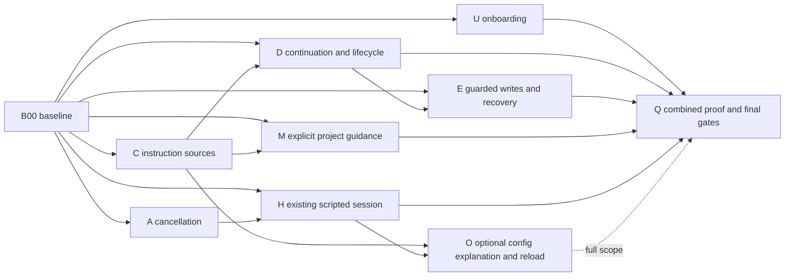

# Native coding parallel schedule

This is a dependency/ownership validation artifact, not a runtime scheduler or a promised calendar. Rows are illustrative conflict-free dispatch sets, assuming equal packet duration. In actual execution, dispatch a ready packet immediately after its producers integrate; do not wait at row barriers. Baseline and final lead gates are shown as exclusive rows. Build semaphore: at most two Cargo processes, including integration.

Core has 51 packets; full has 56. Full adds workflow examples/config explanation/reload through Q03 full-scope dependencies. Release-only uses B00 + A/U and its own milestone-specific review/gate.

## Dependency view

This diagram collapses streams; the JSON dependencies are authoritative. In particular checkpoint storage E05 does not wait for lifecycle implementation, while user-facing recovery E08 waits for deletion support D09. Pure contracts and storage may proceed in parallel with other streams when exports/files are unleased.

## Core illustrative dispatch sets

| Set | Slot 1 | Slot 2 | Slot 3 |
| --- | --- | --- | --- |
| 1 | B00 | — | — |
| 2 | D01 | E01 | A01 |
| 3 | D02 | E02 | E04 |
| 4 | D06 | E09 | A03 |
| 5 | C01 | C02 | D03 |
| 6 | D07 | E03 | E05 |
| 7 | A02 | A04 | U01 |
| 8 | U04 | C03 | D12 |
| 9 | D04 | H01 | M01 |
| 10 | E06 | A05 | U03 |
| 11 | U05 | D11 | E07 |
| 12 | D05 | D09 | M02 |
| 13 | H02 | U06 | — |
| 14 | U02 | H03 | M03 |
| 15 | U07 | — | — |
| 16 | C04 | — | — |
| 17 | D08 | — | — |
| 18 | D10 | — | — |
| 19 | E08 | — | — |
| 20 | M04 | — | — |
| 21 | Q01 | Q02 | — |
| 22 | Q03 | — | — |
| 23 | Q04 | — | — |
| 24 | Q05 | — | — |
| 25 | Q06 | — | — |

## Dependency critical path

Ignoring execution duration and lease contention, one longest core dependency chain is:

`B00 → D01 → D02 → D06 → D07 → D12 → D09 → E08 → Q01 → Q03 → Q04 → Q05 → Q06`

This is a graph-depth result, not the measured wall-clock critical path. Shared CLI/runtime leases can dominate real throughput. Prioritize these producers, keep parser changes short, and use unrelated backend/contract work while they integrate.

## Full illustrative dispatch sets

| Set | Slot 1 | Slot 2 | Slot 3 |
| --- | --- | --- | --- |
| 1 | B00 | — | — |
| 2 | D01 | E01 | A01 |
| 3 | D02 | A03 | E02 |
| 4 | D06 | E04 | E09 |
| 5 | A02 | A04 | U01 |
| 6 | C01 | C02 | D03 |
| 7 | D07 | E03 | E05 |
| 8 | H01 | A05 | U02 |
| 9 | U04 | C03 | D12 |
| 10 | D04 | M01 | O01 |
| 11 | E06 | U03 | D09 |
| 12 | H02 | D11 | E07 |
| 13 | U05 | M02 | U06 |
| 14 | D05 | O02 | — |
| 15 | H03 | M03 | — |
| 16 | U07 | — | — |
| 17 | C04 | O03 | — |
| 18 | D08 | — | — |
| 19 | D10 | — | — |
| 20 | E08 | — | — |
| 21 | M04 | — | — |
| 22 | M05 | O04 | Q01 |
| 23 | Q02 | — | — |
| 24 | Q03 | — | — |
| 25 | Q04 | — | — |
| 26 | Q05 | — | — |
| 27 | Q06 | — | — |

## Shared physical files

The following files have multiple planned writers. The dispatcher excludes them even when lease names differ. NEW shared files are also reserved.

| File | Writers |
| --- | --- |
| `crates/saya-cli/src/agent/context_sources.rs` | C03, D05, M03 |
| `crates/saya-cli/src/agent/mod.rs` | C03, M03 |
| `crates/saya-cli/src/agent/runtime.rs` | C03, M03 |
| `crates/saya-cli/src/agent/tools/database_tools/definitions.rs` | E02, E03 |
| `crates/saya-cli/src/agent/tools/database_tools/workspace_edit_append.rs` | E02, E06 |
| `crates/saya-cli/src/agent/tools/database_tools/workspace_edit_replace.rs` | E02, E06 |
| `crates/saya-cli/src/agent/tools/database_tools/workspace_edit_shared.rs` | E02, E06 |
| `crates/saya-cli/src/agent/tools/database_tools/workspace_write.rs` | E03, E06 |
| `crates/saya-cli/src/cli.rs` | D09, M04, O02, U02 |
| `crates/saya-cli/src/commands/config.rs` | O02, U02 |
| `crates/saya-cli/src/commands/mod.rs` | D09, M04 |
| `crates/saya-cli/src/config/doctor.rs` | O02, U01 |
| `crates/saya-cli/src/interactive/mod.rs` | D10, E08, O03 |
| `crates/saya-cli/src/interactive/session_commands.rs` | C04, D08, D09, D10, E08, M04, O04 |
| `crates/saya-cli/src/interactive/session_emit.rs` | C04, D08, D09, D10, E08, H03, M04, O04 |
| `crates/saya-cli/src/interactive/session_loop.rs` | D04, D08, H02, U05, U07 |
| `crates/saya-cli/src/interactive/session_runtime.rs` | D12, H02, O03 |
| `crates/saya-cli/src/interactive/session_state.rs` | D04, D05, D10 |
| `crates/saya-cli/src/interactive/session_universe.rs` | C03, E06, O03 |
| `crates/saya-cli/src/interactive/tui/dispatch/chain_tests.rs` | C04, D08, D09, D10, E08, M04, O04 |
| `crates/saya-cli/src/interactive/tui/dispatch/session_actions.rs` | C04, D08, D09, D10, E08, M04, O04, U05, U07 |
| `crates/saya-cli/src/interactive/tui/ui/surface/splash.rs` | U03, U07 |
| `crates/saya-cli/src/setup/prompt_provider.rs` | U04, U06 |
| `crates/saya-cli/src/slash.rs` | C04, D08, D09, D10, E08, M04, O04 |
| `crates/saya-cli/src/slash/help.rs` | C04, D08, D09, D10, E08, M04, O04 |
| `crates/saya-cli/src/slash/registry.rs` | C04, D08, D09, D10, E08, M04, O04 |
| `crates/saya-cli/tests/config_doctor.rs` | O02, U02 |
| `crates/saya-cli/tests/tui_pty_smoke.rs` | U05, U07 |
| `crates/saya-cli/tests/turn_file.rs` | H02, H03 |
| `crates/saya-config/src/lib.rs` | C01, O01 |
| `crates/saya-config/src/resolve.rs` | C01, O01 |
| `crates/saya-harness/src/fetch/adapter.rs` | A01, A02 |
| `crates/saya-harness/src/fetch/adapter_tests.rs` | A01, A02 |
| `crates/saya-harness/src/lib.rs` | C02, D12 |
| `crates/saya-harness/src/scratch/tools.rs` | A03, A04 |
| `crates/saya-harness/src/workspace/mod.rs` | E01, E07, E09 |
| `crates/saya-harness/tests/workspace_patch.rs` | E01, E09 |
| `crates/saya-store/src/filesystem.rs` | D02, D06, D07, D11 |
| `crates/saya-store/src/lib.rs` | D02, D06, D11, E05, M02 |
| `crates/saya-store/src/session_lifecycle.rs` | D06, D07, D11 |
| `crates/saya-store/tests/session_lifecycle.rs` | D06, D07 |
| `crates/saya-store/tests/sessions.rs` | D02, D11 |
| `crates/saya-types/src/lib.rs` | D01, E04, M01 |
| `docs/coding-workflows.md` | M05, Q04 |

## Validation performed during planning

- Every packet ID is unique and each dependency resolves.
- Core and full dependency graphs are acyclic.
- Every displayed dispatch set has at most three slots and no intersecting owned files or exclusive leases.
- Every producer precedes its consumer in the displayed sets.
- Existing/new path labels were checked against the reviewed checkout.
- This validates the plan structure only; no Rust build/test, live service, throughput or elapsed-time claim is made.
